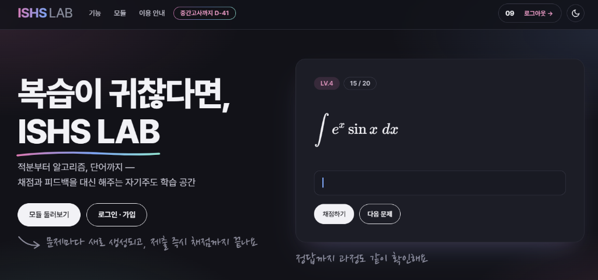

# ISHS Lab



**🌐 Live Demo:** [https://ishslab.dothome.co.kr/index.php](https://ishslab.dothome.co.kr/index.php)

ISHS Lab is an integrated web-based academic platform designed to provide a comprehensive learning environment for mathematics, algorithms, and vocabulary management. The platform is optimized for user experience and learning efficiency, offering tools for continuous practice and evaluation.

## Key Modules

### 1. Integral Studio
An indefinite integral problem generation and verification system powered by Python's SymPy engine.
- **Dynamic Problem Generation:** Automatically generates indefinite integral problems across various difficulty levels in real-time.
- **Strict Validation:** Provides precise grading by mathematically evaluating the equivalence of expressions and strictly checking for the constant of integration (C).

### 2. Coding Test Studio
A comprehensive algorithmic library and practice environment for competitive programming.
- **Algorithm Archive:** Provides standard implementations for over 14 major algorithm categories, including Graph Theory, Dynamic Programming, and Greedy Algorithms.
- **Synchronization System:** Utilizes the `scripts/sync_algorithms.py` script to seamlessly parse local algorithm source files and reflect them on the web viewer.

### 3. Vocabulary Studio
A systematic vocabulary management tool designed for efficient memorization.
- **Customized Flashcards:** Allows users to create personal word lists and self-evaluate their progress through interactive testing interfaces.

### 4. KakaoTalk Analyzer
A client-side analyzer for KakaoTalk chat exports (`kakaotalk.php`). Files are parsed in a Web Worker inside the browser and are never uploaded.
- **Filters:** pick the date range (drag on the timeline), exclude people (bots are detected automatically), limit message types and hours, and merge renamed users.
- **Views:** participant ranking, activity trends and weekday x hour heatmap, keywords (frequent and person-specific, with search), personality titles, reply relationships, an auto-generated report and a searchable transcript.
- **Export:** ranking CSV and a shareable PNG card. Supports the PC and mobile `.txt` exports and `Date,User,Message` CSV.
- **Check:** `node scripts/check_kakaotalk.cjs [export.txt ...]` verifies the parser and the filters against independent line counts.

### 5. Rock ID Studio
A photo quiz for the earth-science rock identification lab (`rocks.php`), covering 22 igneous, sedimentary and metamorphic rocks. Uses the shared studio layout (`style.css`, `studio-layout.css`). No scores are saved to the server; settings and the wrong-answer log stay in localStorage.
- **Modes:** multiple choice (confusable distractors first), typed answers with initial-consonant hints, a timed exam graded at the end, rock-type classification, a study deck with hidden names, and a wrong-answer notebook that records which rocks get mixed up.
- **Photo variation:** random rotation/flip, zoom crop that hides backgrounds and specimen labels, color jitter and grayscale, so students practice on the rock rather than the photo.
- **Data:** `data/rocks/rocks.js`; add photos to `assets/images/rocks/` and list them in a rock's `images` array.

## Project Structure

```text
ISHS_Lab/
├── index.php             # Main portal and landing page
├── modules.php           # Module selection interface
├── coding_test.php       # Algorithm viewer module
├── integral.php          # Integral practice module
├── vocabulary.php        # Vocabulary management module
├── kakaotalk.php         # KakaoTalk chat export analyzer
├── rocks.php             # Rock identification photo quiz
├── data/
│   ├── algorithms/       # Algorithm source codes and categorizations
│   ├── math/             # Mathematics problem data
│   └── english/          # Vocabulary data
├── scripts/
│   ├── sync_algorithms.py# Synchronization tool for algorithm data
│   └── logic.js          # Core frontend logic for modules
└── assets/               # Static assets including CSS and images
```

## Requirements

- **PHP:** 7.0 or higher (Optimized for standard Apache environments)
- **Python:** 3.7 or higher (Required for algorithm data synchronization)

## Installation and Usage

1. Clone the repository to your local web server directory:
   ```bash
   git clone https://github.com/dohye0508/ISHS_Lab.git
   ```

2. Configure your web server to serve the root directory.

3. To synchronize or update the algorithm library data, execute the synchronization script:
   ```bash
   python scripts/sync_algorithms.py
   ```

## Polar-coordinate problem bank

Advanced Math Studio loads `data/math/polar_collections.js` after the general
calculus data. The polar bank contains ten curated sets of five problems:
hidden geometry, tracing and symmetry, region decomposition, and tangents/arc
length. These replace the former 515 parameter-variant questions. Other calculus
sets remain in `adv_collections_final.js`.

Each problem has a stable `template`, a difficulty level, an exact scalar
`solution`, and an `explanation` shown in the results screen. In this file,
`$...$` separates mathematical notation from Korean prose; use braced radicals
such as `\sqrt{2}` in answers. Versioned collection IDs keep old scores separate.
Do not expand the bank by changing coefficients alone: add a new reasoning task
and verify its domain, trace multiplicity, answer, and explanation.

To check the polar mathematical answers and production LaTeX grading, run:

```bash
python -m pip install sympy antlr4-python3-runtime==4.11.1
node scripts/check_polar.cjs python
```

Advanced Math Studio also loads `data/math/inverse_hyperbolic_collections.js`.
The inverse-trigonometric tab has ten collections; the hyperbolic tab has nine
after removal of the out-of-scope catenary collection and supplementary item.
Run its structural,
exact-answer, and production-grader checks with:

```bash
node scripts/check_inverse_hyperbolic.cjs --structure-only
node scripts/check_inverse_hyperbolic.cjs python
```

The last argument may be an absolute Python executable path. These checks do not
call the authentication service or alter the database. Browser layout should
also be checked when changing the statements or renderer.

The September calculus lesson PDFs are covered by
`data/math/lesson_calculus_collections.js`. Its 25 questions are distributed
across the existing subject collections, keeping each at no more than ten questions,
with levels 1–5 and worked solutions. These questions require exact function
answers, while existing antiderivative questions retain their
constant-of-integration behavior. Validate with:

```powershell
node scripts/check_lesson_calculus.cjs --payload | python scripts/check_lesson_calculus.py
```

For this lesson update, upload `adv_math.php`,
`data/math/lesson_calculus_collections.js`, `scripts/logic.js` and
`scripts/grader.js` to their matching hosting paths. The check scripts and
reference PDFs are local development resources.

The hyperbolic/application answer audit recomputes all 70 remaining base answers
from the defining integrals or geometry, checks two valid parameter sets, and
tests equivalent and incorrect answers with the production grader:

```powershell
node scripts/check_calculus_audit.cjs | python scripts/check_calculus_audit.py
node scripts/check_inverse_hyperbolic.cjs --payload | python scripts/check_inverse_hyperbolic.py
```

Upload `data/math/adv_collections_final.js`,
`data/math/inverse_hyperbolic_collections.js`, `scripts/grader.js`,
`adv_math.php`, and `integral.php` for this audit. The page versions refresh
the cached data and grader. No database changes are required.

## Final-exam (기말고사) collections

The Advanced Math Studio collection picker now has two levels: 중간고사 (the
existing trig/hyperbolic/polar/applications/algebra/proof tabs, unchanged) and
기말고사 (급수 and 미분방정식, textbook units III–IV, p.98–191). First visits
open 기말고사 → 급수; the last picked exam and final collection are remembered
per browser in `localStorage` (`adv_last_exam`, `adv_final_selected`).

- `data/math/final/series.js`: 14 series sets, `data/math/final/ode.js`: 2 ODE
  sets, 80 problems, every set at levels 3·4·4·5·5, each with a worked
  explanation and the textbook page shown in the results.
- Answers are exact LaTeX values or functions of `x`, plus three final-only
  forms: `verdict:절대수렴|조건수렴|수렴|발산`, `interval:[a,b)`, and `\infty`.
  `scripts/adv_final_grading.js` grades them; everything else goes to the
  existing SymPy grader. A problem's `tools` (`verdict`, `interval`, `value`,
  `expr`) chooses the answer buttons, so buttons never reveal the answer.
- `scripts/adv_final.js` wraps `gradeProblem`, `loadCurrentProblem` and
  `updateNavButtons` only while `state.exam === 'final'`; midterm grading and
  screens are unchanged, and `grader.js`/`logic.js` are not modified.

Checks (answers are recomputed independently with SymPy, and the browser check
grades every final answer in the real Pyodide grader):

```bash
node scripts/check_final_grading.cjs
node scripts/check_final.cjs --complete python
node scripts/check_final_browser.cjs
```

Upload `adv_math.php`, `scripts/adv_final_grading.js`, `scripts/adv_final.js`,
`data/math/final/series.js` and `data/math/final/ode.js`. No database changes
are required; the check scripts and reference PDFs are local only.

## License

- **Developer:** Dohye Lee
- **Copyright:** © 2026 ISHS Lab. All Rights Reserved.
- **License:** MIT License
